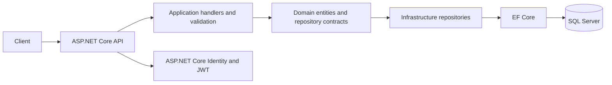

# CRN Technosoft Product API

A .NET 8 ASP.NET Core Web API for managing products and their inventory items. The solution uses a layered design: API controllers, MediatR application handlers, domain entities/repository contracts, and EF Core SQL Server infrastructure.



## Features

- Product CRUD at `/api/products` with bounded pagination (`pageIndex`, `totalLength`, maximum page size 100).
- Item CRUD at `/api/items`, filtered by `productId` and bounded pagination.
- Administrator user listing with bounded pagination.
- JWT bearer authentication; product and item writes require an authorized role.
- ASP.NET Core Identity password hashing and role-based authorization.
- EF Core SQL Server persistence, `AsNoTracking` reads, product list caching, and async query execution.
- FluentValidation for product commands, RFC 7807 problem responses, request rate limiting, CORS allow-listing, response compression, and security headers.
- Swagger UI in Development and JSON structured application logs.
- xUnit/Moq unit tests and Docker Compose for a local API + SQL Server environment.

## Run locally

Install the .NET 8 SDK and SQL Server. Supply configuration outside source control:

```powershell
dotnet user-secrets set "ConnectionStrings:DefaultConnection" "Server=localhost;Database=CRN_Technosoft;Trusted_Connection=True;TrustServerCertificate=True" --project .\CRN_Technosoft.Practical\CRN_Technosoft.API
dotnet user-secrets set "JwtSettings:SecretKey" "<random secret of at least 32 bytes>" --project .\CRN_Technosoft.Practical\CRN_Technosoft.API
dotnet run --project .\CRN_Technosoft.Practical\CRN_Technosoft.API
```

In Development, the API creates the database schema if no EF migrations have been added; otherwise it applies pending migrations. Browse to `https://localhost:7047/swagger` or `http://localhost:5098/swagger`.

To create migrations from Visual Studio's Package Manager Console, target the Infrastructure project (where `ApplicationDbContext` is defined) and use the API as the startup project:

```powershell
Add-Migration InitialCreate -Project CRN_Technosoft.Infrastructure -StartupProject CRN_Technosoft.API
Update-Database -Project CRN_Technosoft.Infrastructure -StartupProject CRN_Technosoft.API
```

## Run with Docker Compose

Copy `.env.example` to `.env`, replace both sample values with strong secrets, then run:

```powershell
docker compose up --build
```

The API is available at `http://localhost:8080/swagger`. Compose uses the development environment to initialize a new local database. Do not use sample credentials in a shared or production environment.

The local `Customer` role is assigned at registration. Product writes require assigning a trusted user to `ProductManager` (or `Admin`/`SuperAdmin`) through a controlled administrative process; public registration cannot grant elevated roles.

## Authentication flow

1. Register with `POST /api/auth/register`.
2. Obtain an access token with `POST /api/auth/login`.
3. Send `Authorization: Bearer <access-token>` on protected endpoints.
4. Exchange the refresh token at `POST /api/auth/refresh` before the access token expires. Refresh tokens are stored as SHA-256 hashes and rotated on use; reuse of a revoked token revokes the user's active refresh tokens.

Access tokens are signed using `JwtSettings:SecretKey`, with issuer, audience, and lifetime configured in `appsettings.json`. Create and store secrets through .NET user-secrets locally or environment variables in deployment; never commit them.

## Product API

| Method | Route | Description |
|---|---|---|
| GET | `/api/products?pageIndex=1&totalLength=10` | List a page of products |
| GET | `/api/products/{id}` | Get one product |
| POST | `/api/products` | Create a product (201 + `Location`) |
| PUT | `/api/products/{id}` | Replace product details |
| DELETE | `/api/products/{id}` | Delete a product (204) |

Product writes require a JWT with one of the `Admin`, `SuperAdmin`, or `ProductManager` roles. Configure `Cors:AllowedOrigins` with the exact trusted client origins; an empty list denies browser cross-origin access.

## Tests

```powershell
dotnet test .\CRN_Technosoft.Practical\CRN_Technosoft.Practical.sln
```

## Deployment notes

Build the API image with `docker compose build api` or build from the solution root with `docker build -f .\CRN_Technosoft.API\Dockerfile .`. Set `ASPNETCORE_ENVIRONMENT=Production`, provide database/JWT secrets through a managed secret store, terminate HTTPS at a trusted TLS endpoint, and apply reviewed EF Core migrations as a deployment step. Do not expose SQL Server publicly in production.

The current project has no committed EF Core migration history. Development and Compose create a new database with `EnsureCreated`; this is only suitable for a fresh local database. Generate and review an initial EF Core migration, and migrate any existing database (including the audit column type change), before deploying to a persistent production database.
